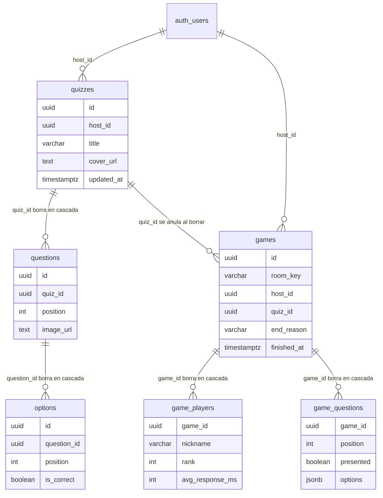

# Modelo de datos

Las tablas del dominio están en el esquema `public`. Las cuentas están en `auth.users` (Supabase Auth) y Drizzle no las migra. El estado de una sala en juego no está aquí: vive en memoria o en Redis.

## Diagrama



## Decisiones

- **El historial es una copia.** `games`, `game_players` y `game_questions` guardan el título, los textos, las opciones y los conteos de esa partida. Borrar o editar el cuestionario vivo no cambia una partida ya cerrada. `games.quiz_id` es nullable y `ON DELETE SET NULL`: si el cuestionario se borra, la partida sigue y pierde solo el enlace.
- **Una partida, una fila.** `games.room_key` es único (`pin:createdAt`). Un segundo guardado de la misma sala no inserta otra fila.
- **Un recurso ajeno no se distingue de uno inexistente.** Toda lectura filtra por `host_id`. Si no hay fila, la API responde 404, no 403, para no confirmar que el id existe.
- **Las opciones del historial van en jsonb.** Son una foto inmutable (`text`, `isCorrect`, `count`). No se vuelven a unir con `options`, porque esa tabla puede cambiar. `count` es null si la pregunta no se presentó.
- **`end_reason`** es `completed` o `hostAbsent`. El cierre por anfitrión ausente también deja historial, con las preguntas no cerradas marcadas como no presentadas.
- **Las imágenes no están en la base.** `cover_url` e `image_url` son la URL del archivo. El archivo vive en disco local o en Supabase Storage.

## Índices y las consultas reales

Medido el 24 de noviembre de 2026 en el Postgres local, con `EXPLAIN` (1 cuestionario del anfitrión de prueba).

Listar cuestionarios del anfitrión, del más reciente al más antiguo:

```text
Index Scan using quizzes_host_id_updated_at_idx on quizzes
  Index Cond: (host_id = ...)
```

Listar partidas del anfitrión por fecha de cierre:

```text
Index Scan using games_host_id_finished_at_idx on games
  Index Cond: (host_id = ...)
```

En ambos el plan usa el índice compuesto `(host_id, fecha DESC)`. Con una fila el plan añade un `Sort` de costo despreciable. El índice ya trae ese orden para cuando haya más filas.

El resto de las lecturas cae en un índice que ya existe:

| Consulta | Índice |
| --- | --- |
| Un cuestionario por `id` y `host_id` | `quizzes_pkey`. El `id` es único; el `host_id` descarta al ajeno |
| Preguntas de un cuestionario, en orden | `questions_quiz_id_position_unique` |
| Opciones de una pregunta, en orden | `options_question_id_position_unique` |
| Jugadores de una partida | `game_players_game_id_join_order_unique`. El orden por puesto se calcula al leer: una partida tiene como máximo 50 personas y no justifica otro índice |
| Preguntas de una partida, en orden | `game_questions_game_id_position_unique` |
| Guardar la misma sala por segunda vez | `games_room_key_unique` |

No hizo falta una migración nueva de índices: las consultas del CRUD y del historial ya están cubiertas.
